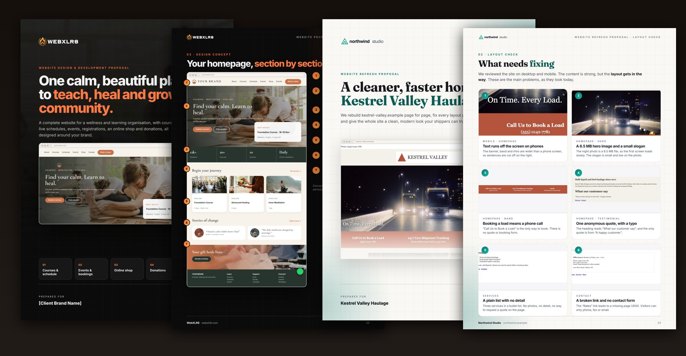
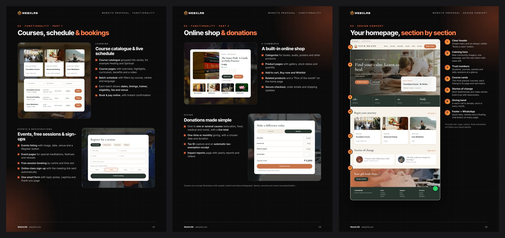
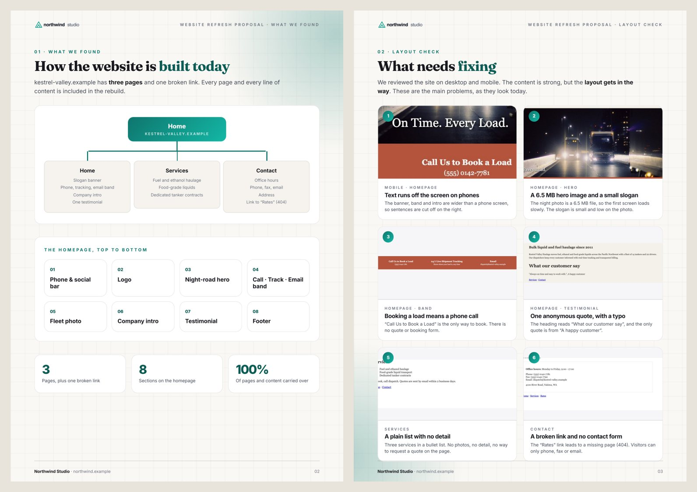
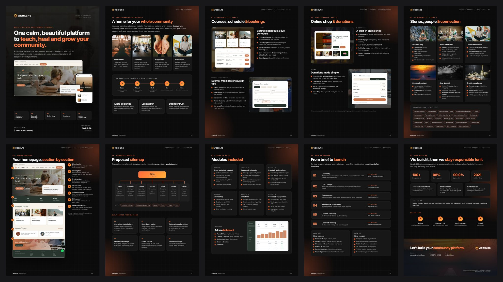
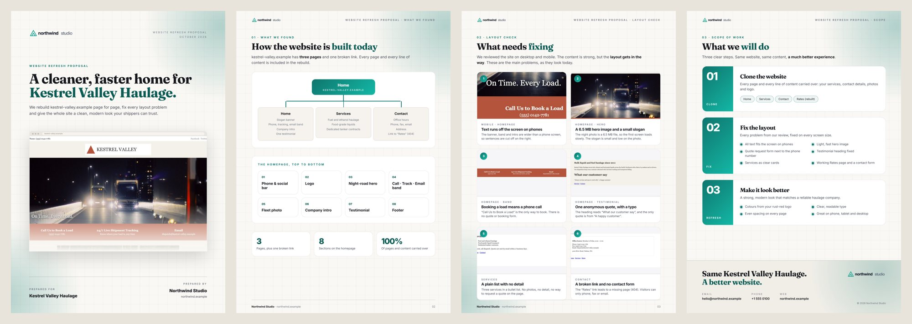

# pitch-proposal: website proposal generator for agencies (Claude Code skill)

[](https://github.com/webxlr8/pitch-proposal/actions/workflows/ci.yml)
[](LICENSE)
[](#install)
[](#what-you-get)

**Turn a client brief, a company profile or a website URL into a branded, client-ready website proposal PDF.**
A [Claude Code](https://claude.com/claude-code) skill for web design agencies, freelancers and IT companies. It reads your branding from your own website, analyses the client's site (or a reference site they like), and writes the scope, sitemap, page plan, functionality list, homepage concept and delivery plan. You get an A4 PDF in your colours, with concept screens and free stock photography, checked before you send it. No prices unless you ask.



> Both examples are in [`examples/`](examples/). The light one is fully fictional ("Northwind Studio" proposing a refresh of the deliberately flawed "Kestrel Valley Haulage" demo site), so you can rebuild every page yourself.

## What you get

Give it one of three inputs:

| You have | Say in Claude Code | You get |
|---|---|---|
| A client brief or company profile (PDF) | *"Create a website proposal for this company"* | A page-by-page website plan: recommended pages, services pages, homepage concept, delivery |
| The client's current website | *"Clone and refresh client.com, fix the layout, nothing else"* | A short, strict proposal: how the site is built today, screenshots of each problem, the 3-step scope |
| A reference website | *"Our client wants a site like example.org, different brand"* | Every function of the reference site, rewritten for the client's future site, with concept screens. The reference brand never appears |

Each proposal is a folder:

```
clients/<client>/
├── proposal.html        the editable source (A4 pages)
├── <Client> Website Proposal - <You>.pdf
├── previews/            one PNG per page + overview.png
├── images/              stock photos (+ credits.json) and screenshot crops
├── site/                crawl results (site.md) and screenshots
└── notes.md             assumptions to confirm before sending
```

## How it works

1. **Your brand, once.** `profile_from_site.py https://your-company.com` reads your logo, brand colours (CSS variables and most-used colours), fonts, contact details, social links and services, and writes a profile. Add your approved proof (stats, client names, how you work) and every proposal reuses it. Several companies? Keep one profile each.
2. **Site analysis.** `crawl_site.py` reads the sitemap (or follows links), then lists the menu, every page, forms and their fields, video and map embeds, shop, checkout, donations, bookings, logins, WhatsApp, analytics, broken links and the tech stack. `screenshots.py` captures desktop and mobile pages for evidence.
3. **Pages from templates.** 15 A4 page types, from cover to "why us": sitemap trees, page plans, numbered problem cards, scope blocks, module grids, delivery phases and concept screens (homepage, schedule, booking form, product page, donation form, admin dashboard).
4. **Images.** Real screenshot crops for problems, and free Unsplash or Pexels photos for concepts, with credits recorded. Never fake photos of the client's business.
5. **Checks before sending.** `build.py` renders the PDF with Chrome and fails on: content overflowing a page, unfilled tokens, placeholder images, prices in the copy (when "no prices" is on), and banned words such as a reference site's name. It warns about leftover template text and half-empty pages, and writes a preview of every page for a final look.

| Concept screens instead of the reference site's screenshots | Evidence from the client's own site |
|---|---|
|  |  |

## Install

As a Claude Code plugin:
```
/plugin marketplace add webxlr8/pitch-proposal
/plugin install pitch-proposal@pitch-proposal
```
Or copy `skills/pitch-proposal` into your project's `.claude/skills/`.

Check your machine:
```bash
pip install -r skills/pitch-proposal/requirements.txt
python3 skills/pitch-proposal/scripts/doctor.py
```

## Use it

In Claude Code, from the folder where you keep your clients:
```
/pitch-proposal:pitch-proposal set up my company from https://your-company.com
/pitch-proposal:pitch-proposal create a website proposal for <client> from this PDF
/pitch-proposal:pitch-proposal clone and refresh https://client.com, layout fixes only, no prices
/pitch-proposal:pitch-proposal proposal for a site like https://reference.org for a new brand
```

Or run the scripts yourself:
```bash
S=skills/pitch-proposal/scripts
python3 $S/profile_from_site.py https://your-company.com --out pitch-profile
python3 $S/crawl_site.py https://client.com --out clients/acme/site
python3 $S/new_proposal.py acme --client "Acme Ltd" --preset refresh --client-domain client.com
python3 $S/stock_photos.py get https://unsplash.com/photos/<id> --out clients/acme/images --name hero
python3 $S/build.py clients/acme
```

Presets: `build` (new platform, 10 pages), `refresh` (clone + fix + improve, 4 pages), `plan` (page-by-page plan from a profile, 8 pages), or any list with `--pages`.

## Two examples

**New platform, dark theme** (WebXLR8 → a wellness and learning organisation, client brand not yet known):



**Website refresh, light theme** (fictional Northwind Studio → fictional Kestrel Valley Haulage):



Rebuild both: `python3 examples/run_examples.py` (the wellness example downloads its free Unsplash photos first).

## Your brand, not ours

Themes are CSS variables. The profile sets the accent colour, background, fonts and logo; `templates/themes/dark.css` and `light.css` provide the rest. Concept screens follow the client's colours through `--c-*` variables, or stay neutral when the client's brand is unknown. See [docs/themes.md](docs/themes.md).

## Honest by design

- Numbers about you come only from your profile's approved proof. Client facts come from their material or their site.
- Problems are listed only when a screenshot shows them.
- No prices, dates or extra services unless you ask; strict-scope proposals stay strict.
- Reference sites are research only: their name, logo, people and wording are blocked by the ban list.
- Stock photos are never presented as the client's own staff or premises.

See [docs/responsible-use.md](docs/responsible-use.md).

## Docs

- [Company profile](docs/profile.md): `company.yaml`, `proof.yaml`, `theme.json`, `brand/`
- [Page types and presets](skills/pitch-proposal/references/page-types.md)
- [Themes](docs/themes.md)
- [Checks](docs/checks.md)
- [Responsible use](docs/responsible-use.md)
- [Contributing](CONTRIBUTING.md) and [changelog](CHANGELOG.md)

## Requirements

Python 3.9+, Google Chrome (or Chromium), and three small packages: Pillow, PyYAML, pypdfium2. No Node, no headless-browser download. Works on macOS, Linux and Windows.

## Related

- [pitch-audit](https://github.com/webxlr8/pitch-audit): audit a prospect's website and get a short pitch deck. Uses the same company profile, so set up once and use both.

---

Made by [WebXLR8](https://webxlr8.com). MIT licensed. Keywords: website proposal template, web design proposal, website redesign proposal, scope of work, sitemap generator, website audit, proposal PDF generator, agency sales, Claude Code skill.
